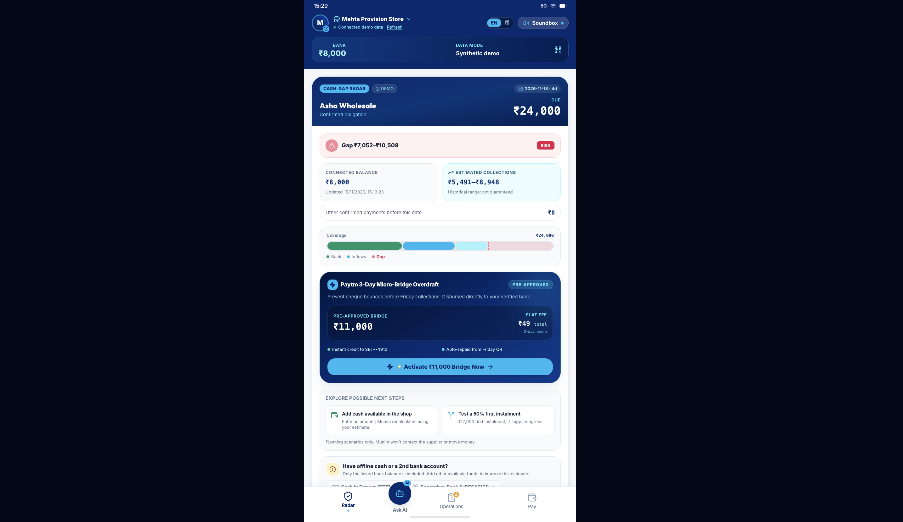
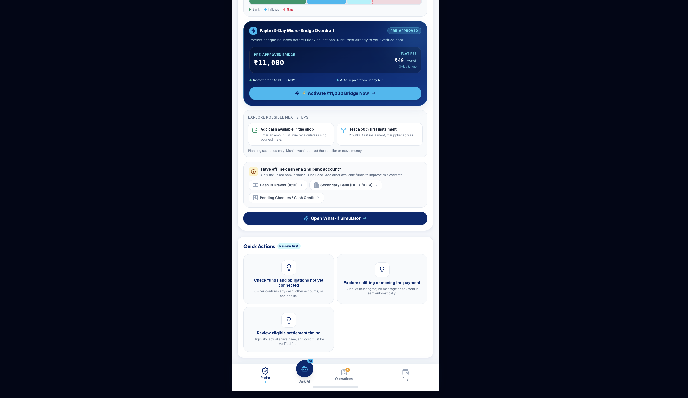
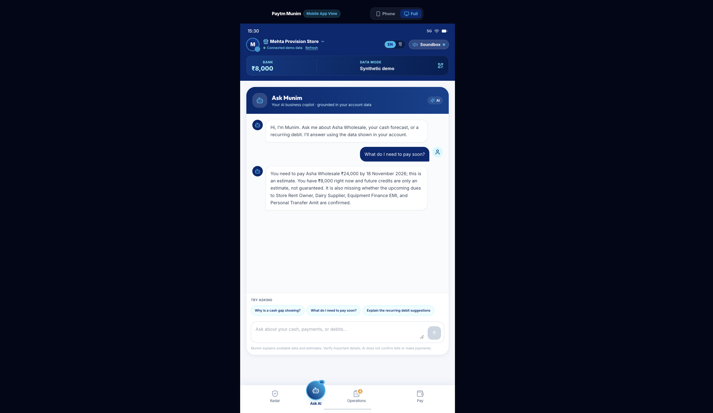
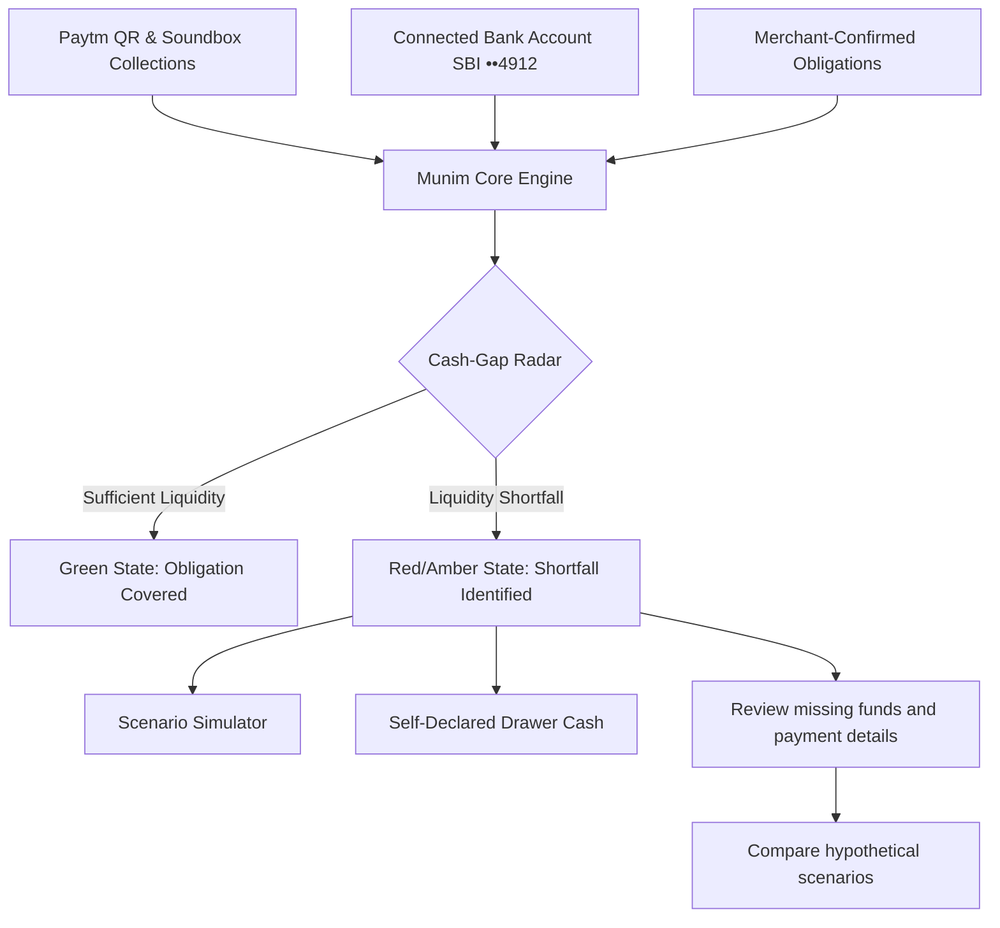

# Paytm Munim (पेटीएम मुनीम)

<div align="center">



### **The Forward-Looking AI Cash-Gap Radar and CFO for Indian Merchants**
*Making upcoming cash needs easier to see, explaining forecast uncertainty, and helping merchants compare practical next steps.*

[](https://fastapi.tiangolo.com)
[](https://react.dev)
[](https://www.typescriptlang.org)
[](https://python.org)
[](backend/tests)
[](https://paytm.com)
[](#quick-start-guide)

[**Live Demo**](#product-interface--architecture-walkthrough) • [**Features**](#core-capabilities--features) • [**Architecture**](#system-architecture) • [**Forecasting Math**](#mathematical-forecasting-model) • [**API Reference**](#api-reference) • [**Setup Guide**](#quick-start-guide)

</div>

---

## Executive Summary & Product Thesis

> *"Over 10 million Indian merchants rely on the Paytm Soundbox to verify incoming retail transactions. However, daily operations present a fundamental timing mismatch: customer collections arrive continuously in micro-amounts, while supplier inventory payments are due in concentrated, lump-sum obligations.  
>  
> Traditional financial management tools act as **rearview mirrors**—they summarize past transactions without offering forward visibility.  
> Merchants require **headlights** to anticipate liquidity positions before supplier commitments mature.  
>  
> **Paytm Munim** is a forward-looking cash-gap forecasting radar built for the Paytm for Business ecosystem."*

### Problem Definition and Solution Matrix

| Operational Challenge | Legacy Approach | Paytm Munim Framework |
|---|---|---|
| **Cash-Flow Timing Mismatches** | Mental arithmetic and static notebooks; unexpected payment defaults. | Multi-day horizon forecasting using 8-week weekday percentile ranges ($P_{10} - P_{90}$). |
| **Supplier Default Risk** | Dishonored cheques, penalty charges, and supplier credit suspension. | Early shortfall warnings 4 to 14 days prior to due dates. |
| **Unclear cash position** | Mental arithmetic across balances, collections, and bills. | A dated cash outlook with evidence, estimates, and missing information clearly labelled. |
| **Algorithmic Reliability** | Uncalibrated LLM chat responses prone to numerical hallucination. | 100% deterministic statistical calculations; AI reserved for unstructured data parsing. |
| **Unrecorded Cash Liquidity** | Incomplete digital visibility (30% to 50% physical cash in retail drawers). | Transparent self-declaration flows for drawer cash without data corruption. |

---

## Product Interface & Architecture Walkthrough

### 1. Cash-Gap Radar & Liquidity Spectrum
The primary dashboard provides merchants with an immediate status assessment: **Safe (Green)**, **Moderate Risk (Amber)**, or **Shortfall Risk (Red)**.

<div align="center">
  
  <p><em>Figure 1: Cash-Gap Radar displaying verified bank metrics, estimated conservative collections, net shortfall, and visual coverage spectrum.</em></p>
</div>

* **Three-Pillar Metrics:** Real-time visibility into verified connected bank balances (`SBI ••4912`), estimated conservative inflows (`₹11,206 to ₹17,773`), and projected net shortfall.
* **Visual Cash Flow Spectrum:** Proportional allocation bar displaying Bank Reserves, Base Inflows, Inflow Upside, and the Shortfall Gap Zone.
* **Blind-Spot Management:** Explicit declaration interface for physical currency notes and secondary banking accounts.

---

### 2. Interactive Scenario Simulator
Merchants evaluate cash management strategies in real-time with sub-50ms deterministic recalculation.

<div align="center">
  
  <p><em>Figure 2: Scenario testing interface with one-touch presets, cash drawer adjustment sliders, and 50% instalment modeling.</em></p>
</div>

* **Structured Presets:** Instant evaluation of Baseline Risk, Additional Cash (+₹17,000), 50% Split Payment, and Due Date Adjustments (+1 day).
* **Controlled Liquidity Inputs:** Sliders for physical drawer funds with instant recalculation.
* **Deterministic Recalculation:** Validated server-side logic returning updated confidence classifications.

---

### 3. Operations Hub & Recurring Debit Intelligence
Munim evaluates 56 days of account debit history to detect regular 30-day supplier cycles without making unsubstantiated assumptions.

<div align="center">
  
  <p><em>Figure 3: Identified candidate recurring obligations, modal confirmation dialogs, and settlement reconciliation streams.</em></p>
</div>

* **Pattern Detection:** Identifies repeating debits (e.g., *Amul Milk Depot ~₹4,500*) and presents them as confirmation queries.
* **Integrated Modal Flows:** In-app dialogs for amount and date verification, avoiding intrusive browser prompt dialogs.
* **Settlement Reconciliation:** Matches Paytm QR transaction records with bank credit events to identify in-transit batches.

---

### 4. Grounded Merchant Copilot
Conversational assistant restricted to verified merchant records, eliminating external factual hallucinations.

<div align="center">
  
  <p><em>Figure 4: Natural language inquiry interface grounded in verified store transaction history and payment schedules.</em></p>
</div>

* **Grounded Responses:** Answers questions regarding shortfall causes and pending supplier dues using current store state.
* **Language Support:** Handles inquiries in English, Hindi, and Hinglish.

---

### 5. Multi-Modal Payment Ingestion & Verification
Converts vernacular voice input into structured financial records.

<div align="center">
  
  <p><em>Figure 5: Voice payment entry powered by Sarvam AI audio transcription and confirmed obligation listing.</em></p>
</div>

* **Voice Transcription:** Transcribes conversational merchant voice notes into structured payee, amount, and due date fields.
* **Payment Handoff:** Previews confirmed obligations with simulated handoff to Paytm payment rails.

---

## Core Capabilities & Features



### 1. Cash-Gap Radar
* Evaluates 8 weeks of historical credit patterns segmented by weekday.
* Models conservative ($P_{10}$) and optimistic ($P_{90}$) collection ranges.
* Generates actionable warnings 4 to 14 days in advance of obligation due dates.

### 2. Merchant-reviewed next steps
* Explains that a cash gap is an estimate based on the visible balance, historical collection range, confirmed obligations, and data coverage.
* Lets the merchant review missing cash or accounts and model a supplier split or timing change as a hypothetical scenario.
* When a gap is possible, the dashboard offers a clearly labelled link to Paytm business-loan information. Applications and eligibility are handled in Paytm; lending partners decide the offer and terms. Munim does not approve or disburse credit, initiate payments, contact suppliers, or move settlement funds.

### 3. Physical Cash & Unlinked Account Declaration
* Addresses the realities of cash-dominant Indian retail operations.
* Captures physical cash in hand, secondary bank holdings, and pending cheques without corrupting verified ledger balances.
* Immediately factors declared amounts into scenario models.

### 4. Soundbox Voice Integration
* Integrates with Web Speech API for localized voice feedback in **Hindi (`hi-IN`)** and **English (`en-IN`)**.
* **Dynamic Audio States:**
  * *Standard Warning:* Announces supplier due date and projected gap range.
  * *Forecast Reminder:* Announces the due date and estimated range, and reminds the merchant that the figures are estimates to review in the app.

### 5. Automated Recurring Debit Detection
* Identifies 30-day periodic bank transfers from historical transaction records.
* Formulates candidates as questions for merchant verification.
* Uses native mobile sheet dialogs for editing and confirmation.

---

## Mathematical Forecasting Model

Financial forecasting requires strict determinism. Paytm Munim's computation engine is implemented entirely in deterministic Python logic using non-parametric quantile estimation:

### 1. Weekday Percentile Aggregation
For each day of week $w \in \{0, 1, \dots, 6\}$ across the prior 56 days (8 weeks):

$$P_{10}(w) = \text{percentile}(\text{credits}_w, 0.10), \quad P_{90}(w) = \text{percentile}(\text{credits}_w, 0.90)$$

$$\text{Inflow}_{\text{low}} = \sum_{d = \text{today} + 1}^{\text{due}} P_{10}(\text{weekday}(d)), \quad \text{Inflow}_{\text{high}} = \sum_{d = \text{today} + 1}^{\text{due}} P_{90}(\text{weekday}(d))$$

### 2. Available Liquidity Calculations
Accounts for verified balances, owner-defined reserve floors, concurrent commitments, and temporary scenario funds:

$$\text{Funds}_{\text{low}} = \text{Balance} + \text{Inflow}_{\text{low}} - \text{Obligations}_{\text{other}} - \text{Reserve Floor} + \text{Extra Funds}$$

$$\text{Funds}_{\text{high}} = \text{Balance} + \text{Inflow}_{\text{high}} - \text{Obligations}_{\text{other}} - \text{Reserve Floor} + \text{Extra Funds}$$

### 3. Shortfall Bounds
Shortfall ranges are calculated as:

$$\text{Gap}_{\text{low}} = \max\left(0, \text{Obligation Amount} - \text{Funds}_{\text{high}}\right)$$

$$\text{Gap}_{\text{high}} = \max\left(0, \text{Obligation Amount} - \text{Funds}_{\text{low}}\right)$$

* If $\text{Gap}_{\text{high}} = 0 \implies \mathbf{SAFE}$ (All obligations covered under conservative projections).
* If $\text{Gap}_{\text{high}} > 0 \land \text{Gap}_{\text{low}} = 0 \implies \mathbf{MONITOR}$ (Covered under upside projections; shortfall possible under conservative inflows).
* If $\text{Gap}_{\text{low}} > 0 \implies \mathbf{SHORTFALL\ RISK}$ (Shortfall expected across all historical percentile projections).

---

## System Architecture

```
+------------------------------------------------------------------------+
|                   Paytm Munim Mobile App (React 18 + Vite)             |
|  +-----------------------+ +----------------------+ +----------------+ |
|  |   CashGapRadar.tsx    | |  JudgePlayground.tsx | |  MunimCopilot  | |
|  |  (Liquidity Metrics)  | |  (Scenario Testing)  | |  (Store Query) | |
|  +-----------------------+ +----------------------+ +----------------+ |
|  +-----------------------+ +----------------------+ +----------------+ |
|  |  ActionAdvisor.tsx  | | BlindSpotBanner.tsx  | | SoundboxPlayer | |
|  | (Review Options)  | | (Drawer Cash Input)  | |(Voice Engine)  | |
|  +-----------------------+ +----------------------+ +----------------+ |
+-----------------------------------+-+----------------------------------+
                                    | HTTP / JSON (Bearer Token)
                                    v
+------------------------------------------------------------------------+
|                   FastAPI Backend Core (Python 3.11+)                  |
|  +------------------+  +------------------+  +----------------------+  |
|  |   forecast.py    |  |   decisions.py   |  |     insights.py      |  |
|  | (Quantile Engine)|  | (Decision Matrix)|  | (Pattern Discovery)  |  |
|  +------------------+  +------------------+  +----------------------+  |
|  +------------------+  +------------------+  +----------------------+  |
|  |      ai.py       |  |     auth.py      |  |      service.py      |  |
|  |  (Audio / NLP)   |  | (Tenant Context) |  |   (Data Mutation)    |  |
|  +------------------+  +------------------+  +----------------------+  |
+-----------------------------------+-+----------------------------------+
                                    | SQLAlchemy ORM
                                    v
+------------------------------------------------------------------------+
|               Database Layer (SQLite / PostgreSQL + Alembic)           |
|  +---------------+ +---------------+ +--------------+ +-------------+  |
|  |   Merchants   | |  MoneyEvents  | | BalanceSnaps | | Obligations |  |
|  +---------------+ +---------------+ +--------------+ +-------------+  |
|  +-------------------------------+  +-------------------------------+  |
|  |         ForecastRuns          |  |          AuditEvents          |  |
|  +-------------------------------+  +-------------------------------+  |
+------------------------------------------------------------------------+
```

---

## API Reference

All `/v1/` endpoints enforce tenant isolation using standard Bearer token authorization:

| Method | Endpoint | Description |
|---|---|---|
| `GET` | `/health` | Healthcheck verification (`{ "status": "ok" }`). |
| `POST` | `/demo/token?merchant_id=shop1` | Generates authenticated demo JWT Bearer token. |
| `GET` | `/v1/obligations` | Lists confirmed upcoming payment obligations. |
| `POST` | `/v1/obligations` | Creates a new confirmed supplier payment obligation. |
| `PATCH` | `/v1/obligations/{id}` | Updates obligation amount, due date, or version status. |
| `GET` | `/v1/obligations/{id}/forecast` | Runs 8-week statistical quantile forecast and returns gap bounds. |
| `POST` | `/v1/obligations/{id}/scenarios` | Executes sub-50ms deterministic scenario with cash or terms modifications. |
| `GET` | `/v1/obligations/{id}/advice` | Returns evaluated decision matrix options. |
| `GET` | `/v1/obligation-candidates` | Identifies 30-day recurring debits requiring merchant confirmation. |
| `GET` | `/v1/settlement-unmatched` | Cross-references QR transaction records with bank settlement batches. |
| `POST` | `/v1/ai/payment-draft` | Extracts structured obligations from natural language text. |
| `POST` | `/v1/ai/voice-payment-draft` | Transcribes audio recordings into structured payment drafts. |
| `GET` | `/v1/audit` | Retrieves immutable audit trail of forecast executions and credit events. |

---

## Quick Start Guide

### Environment Prerequisites
* Python 3.11 or higher
* Node.js 18 or higher (with npm)
* `uv` package manager

### 1. Backend Initialization & Seeding
```bash
# Navigate to backend directory
cd backend

# Synchronize dependencies with uv
uv sync --extra dev

# Run database schema migrations
uv run alembic upgrade head

# Seed synthetic fixtures (shop1, Gupta Traders obligation, 48 credit transactions)
uv run python seed_demo.py

# Launch FastAPI application server on port 8000
uv run uvicorn munim.api:app --reload --port 8000
```
*API server runs at `http://127.0.0.1:8000` with documentation available at `http://127.0.0.1:8000/docs`.*

### 2. Frontend Initialization
```bash
# In a separate terminal session, navigate to frontend
cd frontend

# Install dependencies
npm install

# Start development server
npm run dev
```
*Access the mobile dashboard interface at `http://localhost:3000`.*

---

## Verification and Test Coverage

The solution maintains automated testing across both application tiers:

### Backend Test Suite (Pytest)
```bash
cd backend
uv run pytest -v
```
```text
tests/test_api.py::test_unauthenticated_and_paytm_only PASSED            [ 12%]
tests/test_api.py::test_idempotent_ingest_and_conflict PASSED            [ 25%]
tests/test_api.py::test_forecast_scenarios_and_stale_version PASSED      [ 37%]
tests/test_api.py::test_stale_balance_never_produces_cash_gap PASSED     [ 50%]
tests/test_api.py::test_reserve_floor_is_owner_controlled PASSED         [ 62%]
tests/test_api.py::test_tenant_scope PASSED                              [ 75%]
tests/test_api.py::test_revoked_consent_withdraws_gap PASSED             [ 87%]
tests/test_api.py::test_unmatched_payment_is_not_called_delayed PASSED   [100%]
========================= 8 passed, 1 warning in 0.44s =========================
```

### Frontend Production Build
```bash
cd frontend
npm run build
```
```text
✓ 1593 modules transformed.
dist/index.html                   1.14 kB | gzip:  0.64 kB
dist/assets/index-Dc1p3i89.css   35.36 kB | gzip:  6.63 kB
dist/assets/index-Blm68MkC.js   255.99 kB | gzip: 76.69 kB
✓ built in 1.66s
```

---

## Repository Structure

```text
paytm-munim/
├── product_images/              # High-resolution application screenshots
│   ├── 01_cash_gap_radar.png
│   ├── 02_what_if_simulator.png
│   ├── 03_operations_and_candidates.png
│   ├── 04_ask_munim_copilot.png
│   └── 05_payment_flow_voice.png
├── backend/                     # Python FastAPI Backend
│   ├── src/munim/
│   │   ├── api.py               # REST API route handlers
│   │   ├── forecast.py          # Quantile cash-flow engine
│   │   ├── decisions.py         # Decision guidance matrix
│   │   ├── insights.py          # Pattern discovery and settlement reconciliation
│   │   ├── ai.py                # Voice processing and language parsing
│   │   ├── models.py            # SQLAlchemy database entities
│   │   └── schemas.py           # Strict Pydantic models
│   ├── tests/                   # Pytest test suites
│   ├── migrations/              # Alembic schema definitions
│   ├── seed_demo.py             # Demo dataset initialization
│   └── pyproject.toml           # Backend project configuration
├── frontend/                    # React 18 Mobile Application
│   ├── src/
│   │   ├── components/
│   │   │   ├── CashGapRadar.tsx         # Primary Radar card and spectrum bar
│   │   │   ├── ActionAdvisor.tsx      # Merchant-reviewed scenario options
│   │   │   ├── LoanOptionsCard.tsx    # Optional hand-off to Paytm loan information
│   │   │   ├── BlindSpotBanner.tsx      # Physical cash declaration interface
│   │   │   ├── JudgePlayground.tsx      # Scenario simulation interface
│   │   │   ├── CandidateObligations.tsx # Recurring debit confirmation interface
│   │   │   ├── MunimCopilot.tsx         # Grounded AI chat interface
│   │   │   ├── PaymentFlow.tsx          # Vernacular voice drafting
│   │   │   ├── SoundboxPlayer.tsx       # Localized voice broadcast engine
│   │   │   ├── MobileHeader.tsx         # Account profile and balances
│   │   │   └── MobileBottomNav.tsx      # Bottom navigation controls
│   │   ├── api.ts                       # Backend client connector
│   │   ├── types.ts                     # TypeScript domain interfaces
│   │   └── mockData.ts                  # Synthetic fallback fixtures
│   ├── tailwind.config.js       # Design tokens and theme settings
│   └── package.json             # Frontend dependencies
└── docs/                        # Formal 9-part product documentation
```

---

## Governance, Evidence Boundaries & Responsible AI

Paytm Munim is built upon explicit operational boundaries:

1. **Past debits are candidate queries, not verified liabilities:** Repeating transaction history is presented as candidate questions. Obligations are registered only upon explicit merchant confirmation.
2. **Inflow forecasts are probability ranges, not settled assets:** Projections represent statistical intervals ($P_{10}$ to $P_{90}$) based on historical bank activity, not guaranteed future liquidity.
3. **Paytm platform views do not reflect total enterprise liquidity:** Munim avoids claims of complete financial visibility by providing explicit declaration interfaces for unbanked cash and secondary institutions.
4. **Deterministic math over language-model arithmetic:** Numerical forecasting, reserve deductions, and shortfall calculations are executed in deterministic code, completely avoiding generative arithmetic.

---

<div align="center">

**Paytm Munim — Financial Foresight for Indian Commerce.**

</div>
