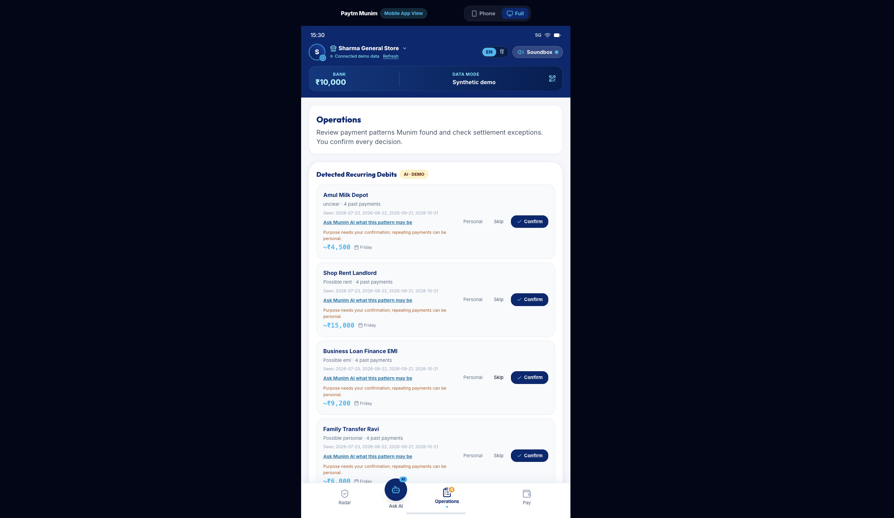
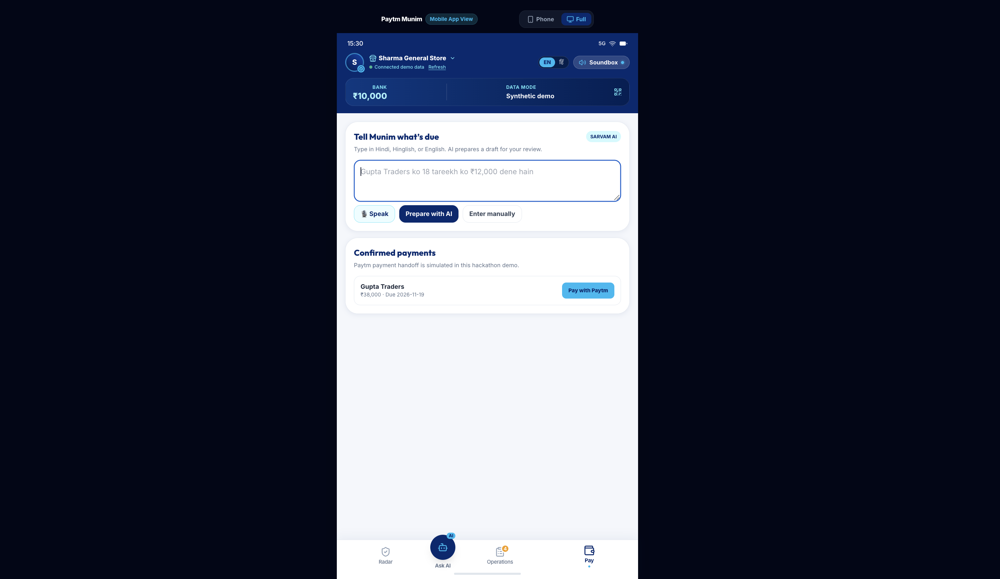
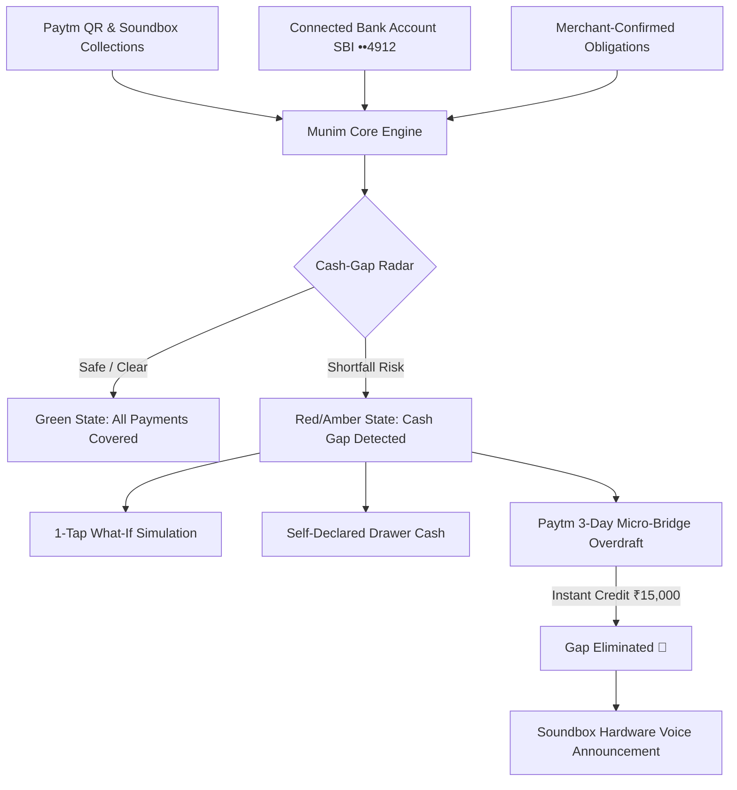

# ⚡ Paytm Munim (पेटीएम मुनीम)

<div align="center">


### **The Forward-Looking AI Cash-Gap Radar & CFO for 10M+ Indian Merchants**
*Predicting cash shortfalls before cheques bounce, offering instant pre-approved bridge liquidity, and protecting merchant credit reputation.*

[](https://fastapi.tiangolo.com)
[](https://react.dev)
[](https://www.typescriptlang.org)
[](https://python.org)
[](backend/tests)
[](https://paytm.com)
[](#quick-start)

[**Live Demo**](#live-demo--walkthrough) • [**Features**](#key-features--capabilities) • [**Architecture**](#system-architecture) • [**Forecasting Math**](#mathematical-forecasting-model) • [**API Docs**](#api-reference) • [**Setup Guide**](#quick-start-demo-mode)

</div>

---

## 🎯 Executive Summary & The Pitch

> *"Every Indian knows this sound: **‘Paytm par ₹50 prapt hue.’**  
> Over 10 million shopkeepers hear it all day long. But what happens at 8 PM when the shutters go down?  
>  
> The shopkeeper opens a diary full of scribbles. On Thursday, his distributor is coming to collect ₹38,000. And he asks himself: **‘Will my bank account bounce, or do I have enough money?’**  
>  
> Existing apps like Khatabook or banking portals are **rearview mirrors**—they only tell you what you spent yesterday.  
> **A merchant doesn't need a rearview mirror. They need headlights.**  
>  
> Meet **Paytm Munim**—the forward-looking AI Cash-Gap Radar built natively into Paytm for Business."*

### The Fundamental Problem vs. The Munim Solution

| The Old Way (Mental Math & Anxiety) | The Paytm Munim Way |
|---|---|
| **Rearview Accounting:** Apps only record past transactions; zero foresight. | **Forward-Looking Radar:** Forecasts 4–14 days ahead using 8-week weekday percentile ranges. |
| **Bounced Cheques & Penalty Fees:** Supplier cheques bounce due to mistimed settlements. | **Proactive Alerts:** Warns of cash-flow shortfalls days in advance with confidence bounds. |
| **Loan Shark Extortion:** Merchants take emergency loans at 3–5% monthly interest. | **Paytm 3-Day Micro-Bridge:** Pre-approved instant credit for a flat ₹49 fee, auto-repaid via QR. |
| **LLM Hallucinations in Finance:** ChatGPT chatbots guess arithmetic and hallucinate balances. | **100% Deterministic Math:** Python statistical quantile engine; AI strictly for pattern discovery. |
| **Blind to Cash Sales:** Apps ignore 40% of retail transactions sitting in the cash drawer (*गल्ला*). | **Transparent Blind-Spot Handling:** Declares physical drawer cash and secondary accounts safely. |

---

## 📸 Product Walkthrough & Interface Gallery

### 1. Cash-Gap Radar & Real-Time Liquidity Spectrum
The primary dashboard gives shopkeepers an instant 3-second diagnostic: **Safe (Green)**, **Moderate (Amber)**, or **Shortfall Risk (Red)**.

<div align="center">
  
  <p><em>Fig 1: Cash-Gap Radar with 3 micro-metric cards (Bank, Expected Inflow Range, Net Shortfall) and the Visual Cash Flow Spectrum bar.</em></p>
</div>

* **3-Pillar Micro-Metrics:** Shows verified connected bank balance (`SBI ••4912`), estimated conservative inflows (`₹11,206–₹17,773`), and net shortfall.
* **Visual Cash Flow Spectrum:** Color-coded coverage bar showing Bank Reserve (Emerald), Base Inflows (Cyan), Upside Inflows, and the Shortfall Gap Zone.
* **Offline & Drawer Cash Banner:** Explicitly accounts for physical cash in the shop drawer (*गल्ला*) or secondary bank accounts without corrupting verified data.

---

### 2. Interactive "What-If" Payment Plan Simulator
Merchants can test scenarios in real-time with sub-50ms deterministic recalculation and instant visual feedback.

<div align="center">
  
  <p><em>Fig 2: Judge What-If Simulator with 1-click presets, drawer cash slider, 50% split toggle, and confetti on gap elimination.</em></p>
</div>

* **1-Tap Pitch Presets:** Instant testing of Baseline Risk, +₹17k Cash, 50% Split Payment, or Friday Date Shift.
* **Cash Slider & Quick Chips:** Adjust unbanked drawer cash (+₹5k, +₹10k, +₹17k bridge).
* **Live Mathematical Verification:** Updates shortfall calculations deterministically; fires celebration confetti 🎉 upon reaching safety.

---

### 3. Operations Hub & AI Recurring Debit Detection
Munim scans 56 days of bank debit events to automatically identify periodic suppliers and bills without assuming them as facts.

<div align="center">
  
  <p><em>Fig 3: Candidate Recurring Debits discovered by AI, one-tap in-app confirmation modal, and settlement reconciliation.</em></p>
</div>

* **AI Pattern Discovery:** Flags repeating 30-day debits (e.g. *Amul Milk Depot ~₹4,500*) as questions for merchant confirmation.
* **Zero-Prompt In-App Dialogs:** Seamless mobile modal sheet for editing amount and due date—eliminating clunky browser popups.
* **Settlement Reconciliation:** Matches Paytm QR collection events against bank settlement records to detect in-transit payments.

---

### 4. Ask Munim — Grounded Business Copilot
Conversational AI copilot grounded strictly in the merchant's financial records, preventing generic hallucinations.

<div align="center">
  
  <p><em>Fig 4: Ask Munim conversational copilot answering merchant questions in plain Hindi/English with grounded store context.</em></p>
</div>

* **Grounded Responses:** Answers questions like *"Why is a cash gap showing?"* or *"What do I need to pay soon?"* using live store facts.
* **Natural Dialogue:** Supports multi-turn queries in English, Hindi, and Hinglish.

---

### 5. Multi-Lingual Voice Draft & Payment Flow
Integrates voice note transcription with AI to prepare structured obligations from everyday shopkeeper speech.

<div align="center">
  
  <p><em>Fig 5: Voice payment entry powered by Sarvam AI audio processing and confirmed payment list with simulated Paytm handoff.</em></p>
</div>

* **Voice Transcription:** Speak naturally (e.g. *"Gupta Traders ko 18 tareekh ko ₹12,000 dene hain"*); extracts payee, amount, and due date.
* **Pay with Paytm Simulation:** Review confirmed supplier bills and simulate one-tap payment handoff through Paytm UPI.

---

## 🚀 Key Features & Capabilities



### 1. 🛡️ The Cash-Gap Radar (Headlights, Not Rearview Mirrors)
* Analyses 8 weeks of historical credit patterns broken down by weekday.
* Models conservative ($P_{10}$) and optimistic ($P_{90}$) inflows to avoid false promises.
* Alerts the merchant 4–7 days before a supplier obligation is due.

### 2. ⚡ Paytm 3-Day Micro-Bridge Overdraft (The Monetization Engine)
* When organic options (drawer cash or split payments) cannot bridge the gap, Paytm offers an **instant, pre-approved 3-day micro-overdraft**.
* **Terms:** Flat ₹49 fee, zero compound interest, disbursed in 30 seconds directly to `SBI ••4912`.
* **Zero Credit Risk for Paytm:** Automatically repaid from Friday's incoming QR settlement batches.
* **Audit Trail:** Generates a real tracking loan reference (e.g., `#PAYTM-OD-9482`) and logs an immutable audit event in the database.

### 3. 💵 Physical Drawer Cash & Unlinked Accounts (*गल्ला*)
* Solves the reality of Indian retail where 30–60% of sales are in cash.
* Transparently captures physical cash in drawer, secondary bank accounts (e.g., HDFC/ICICI), or pending cheques without corrupting verified bank snapshots.
* Immediately updates the scenario forecast upon declaration.

### 4. 🔊 Paytm Soundbox Hardware Voice Emulation
* Integrates with the browser Web Speech API in **Hindi (`hi-IN`)** and **English (`en-IN`)**.
* **Dynamic Speech Sync:**
  * *Default Warning:* Broadcasts supplier payment due date and gap warning.
  * *Bridge Disbursed:* Announces: *“पेटीएम मुनीम सूचना: तीन दिन का ब्रिज लोन स्वीकृत। बैंक खाते में पंद्रह हज़ार रुपये जमा। गुप्ता ट्रेडर्स का भुगतान अब सुरक्षित है।”*

### 5. 🔍 AI Recurring Debit Discovery & In-App Modals
* Scans past 56 days of bank debit events for periodic 30-day patterns.
* Suggests candidate obligations as questions (e.g., *“Is ₹4,500 due to Amul Milk Depot on the 20th?”*).
* Zero native browser `window.prompt` alerts; uses smooth mobile modal dialogs for full control.

---

## 📐 Mathematical Forecasting Model

Finance cannot tolerate LLM hallucinations. Paytm Munim's forecasting engine is **100% deterministic code** implementing non-parametric quantile estimation:

### 1. Weekday Percentile Aggregation
For each day of week $w \in \{0, 1, \dots, 6\}$ over the past 8 weeks (56 days):

$$P_{10}(w) = \text{percentile}(\text{credits}_w, 0.10), \quad P_{90}(w) = \text{percentile}(\text{credits}_w, 0.90)$$

$$\text{Inflow}_{\text{low}} = \sum_{d = \text{today} + 1}^{\text{due}} P_{10}(\text{weekday}(d)), \quad \text{Inflow}_{\text{high}} = \sum_{d = \text{today} + 1}^{\text{due}} P_{90}(\text{weekday}(d))$$

### 2. Net Available Liquidity
Accounting for verified balance, reserve floors, other confirmed obligations, and declared extra funds:

$$\text{Funds}_{\text{low}} = \text{Balance} + \text{Inflow}_{\text{low}} - \text{Obligations}_{\text{other}} - \text{Reserve Floor} + \text{Extra Funds}$$

$$\text{Funds}_{\text{high}} = \text{Balance} + \text{Inflow}_{\text{high}} - \text{Obligations}_{\text{other}} - \text{Reserve Floor} + \text{Extra Funds}$$

### 3. Exact Gap Bounds
The possible shortfall gap is bounded deterministically:

$$\text{Gap}_{\text{low}} = \max\left(0, \text{Obligation Amount} - \text{Funds}_{\text{high}}\right)$$

$$\text{Gap}_{\text{high}} = \max\left(0, \text{Obligation Amount} - \text{Funds}_{\text{low}}\right)$$

* If $\text{Gap}_{\text{high}} = 0 \implies \mathbf{SAFE}$ (All commitments covered in visible scope).
* If $\text{Gap}_{\text{high}} > 0 \land \text{Gap}_{\text{low}} = 0 \implies \mathbf{MONITOR}$ (Covered at high inflow, possible risk at low inflow).
* If $\text{Gap}_{\text{low}} > 0 \implies \mathbf{SHORTFALL\ RISK}$ (Shortfall likely across all reasonable inflow outcomes).

---

## 🏗️ System Architecture

```
┌────────────────────────────────────────────────────────────────────────┐
│                   Paytm Munim Mobile App (React 18 + Vite)             │
│  ┌───────────────────────┐ ┌──────────────────────┐ ┌───────────────┐ │
│  │   CashGapRadar.tsx    │ │  JudgePlayground.tsx │ │ MunimCopilot  │ │
│  │  (3-Pillar Metrics)   │ │  (What-If Sandbox)   │ │  (AI Copilot) │ │
│  └───────────────────────┘ └──────────────────────┘ └───────────────┘ │
│  ┌───────────────────────┐ ┌──────────────────────┐ ┌───────────────┐ │
│  │  PaytmBridgeCard.tsx  │ │ BlindSpotBanner.tsx  │ │SoundboxPlayer │ │
│  │  (Micro-Overdraft OD) │ │ (Offline Drawer Cash)│ │(Hindi/English)│ │
│  └───────────────────────┘ └──────────────────────┘ └───────────────┘ │
└───────────────────────────────────┬────────────────────────────────────┘
                                    │ HTTP / JSON (Bearer Token)
                                    ▼
┌────────────────────────────────────────────────────────────────────────┐
│                   FastAPI Backend Core (Python 3.11+)                  │
│  ┌──────────────────┐  ┌──────────────────┐  ┌──────────────────────┐  │
│  │   forecast.py    │  │   decisions.py   │  │     insights.py      │  │
│  │ (Percentile Math)│  │ (Decision Engine)│  │(Pattern Recognition) │  │
│  └──────────────────┘  └──────────────────┘  └──────────────────────┘  │
│  ┌──────────────────┐  ┌──────────────────┐  ┌──────────────────────┐  │
│  │      ai.py       │  │     auth.py      │  │      service.py      │  │
│  │(Sarvam/Audio AI) │  │(Tenant Isolation)│  │  (Audit & Mutation)  │  │
│  └──────────────────┘  └──────────────────┘  └──────────────────────┘  │
└───────────────────────────────────┬────────────────────────────────────┘
                                    │ SQLAlchemy ORM
                                    ▼
┌────────────────────────────────────────────────────────────────────────┐
│               Database Layer (SQLite / PostgreSQL + Alembic)           │
│  ┌───────────────┐ ┌───────────────┐ ┌──────────────┐ ┌─────────────┐  │
│  │   Merchants   │ │  MoneyEvents  │ │ BalanceSnaps │ │ Obligations │  │
│  └───────────────┘ └───────────────┘ └──────────────┘ └─────────────┘  │
│  ┌───────────────────────────────┐  ┌───────────────────────────────┐  │
│  │         ForecastRuns          │  │          AuditEvents          │  │
│  └───────────────────────────────┘  └───────────────────────────────┘  │
└────────────────────────────────────────────────────────────────────────┘
```

---

## 📡 API Reference

All `/v1/` endpoints enforce multi-tenant isolation via Bearer Token authentication:

| Method | Endpoint | Description |
|---|---|---|
| `GET` | `/health` | Healthcheck returning `{ "status": "ok" }`. |
| `POST` | `/demo/token?merchant_id=shop1` | Obtains authenticated demo JWT Bearer token. |
| `GET` | `/v1/obligations` | Lists all merchant-confirmed upcoming obligations. |
| `POST` | `/v1/obligations` | Creates a new confirmed supplier payment obligation. |
| `PATCH` | `/v1/obligations/{id}` | Updates amount, due date, or version with optimistic concurrency. |
| `GET` | `/v1/obligations/{id}/forecast` | Runs 8-week statistical percentile forecast and returns gap bounds. |
| `POST` | `/v1/obligations/{id}/scenarios` | Executes sub-50ms deterministic what-if scenario with extra funds/split. |
| `POST` | `/v1/obligations/{id}/bridge-credit` | **Disburses 3-day pre-approved micro-overdraft**, logs audit, and updates forecast. |
| `GET` | `/v1/obligations/{id}/advice` | Returns decision matrix options (`DECLARE_CASH`, `SPLIT_PAYMENT`, `PAYTM_BRIDGE_OVERDRAFT`). |
| `GET` | `/v1/obligation-candidates` | AI discovery of 30-day recurring debits needing merchant confirmation. |
| `GET` | `/v1/settlement-unmatched` | Cross-references Paytm QR collection events against bank settlement credits. |
| `POST` | `/v1/ai/payment-draft` | Natural language text parsing into structured obligation drafts. |
| `POST` | `/v1/ai/voice-payment-draft` | Voice note audio transcription and draft extraction. |
| `GET` | `/v1/audit` | Audit log of all balance refreshes, scenario calculations, and bridge loans. |

---

## ⚡ Quick Start (Demo Mode)

### Prerequisites
* Python 3.11+
* Node.js 18+ & npm
* [`uv`](https://github.com/astral-sh/uv) (Fast Python package manager)

### 1. Backend Setup & Seed Data
```bash
# Navigate to backend directory
cd backend

# Install dependencies using uv
uv sync --extra dev

# Run database migrations
uv run alembic upgrade head

# Seed demo merchant (shop1), Gupta Traders obligation, and 48 credit transactions
uv run python seed_demo.py

# Start the FastAPI server on port 8000
uv run uvicorn munim.api:app --reload --port 8000
```
*API will be live at `http://127.0.0.1:8000` with Swagger docs at `http://127.0.0.1:8000/docs`.*

### 2. Frontend Setup
```bash
# In a new terminal, navigate to frontend directory
cd frontend

# Install node dependencies
npm install

# Start the Vite development server
npm run dev
```
*Open **`http://localhost:3000`** in your browser. Toggle between Phone View and Full Screen using the top toggle.*

---

## 🧪 Testing & Verification

Paytm Munim is built with production rigor. Both test suites run cleanly out of the box:

### Backend Unit & Integration Tests (Pytest)
```bash
cd backend
uv run pytest -v
```
**Output:**
```text
tests/test_api.py::test_unauthenticated_and_paytm_only PASSED            [ 12%]
tests/test_api.py::test_idempotent_ingest_and_conflict PASSED            [ 25%]
tests/test_api.py::test_forecast_scenarios_and_stale_version PASSED      [ 37%]
tests/test_api.py::test_stale_balance_never_produces_cash_gap PASSED     [ 50%]
tests/test_api.py::test_reserve_floor_is_owner_controlled PASSED         [ 62%]
tests/test_api.py::test_tenant_scope PASSED                              [ 75%]
tests/test_api.py::test_revoked_consent_withdraws_gap PASSED             [ 87%]
tests/test_api.py::test_unmatched_payment_is_not_called_delayed PASSED   [100%]
========================= 8 passed, 1 warning in 0.44s =========================
```

### Frontend Typecheck & Production Build
```bash
cd frontend
npm run build
```
**Output:**
```text
✓ 1593 modules transformed.
dist/index.html                   1.14 kB │ gzip:  0.64 kB
dist/assets/index-Dc1p3i89.css   35.36 kB │ gzip:  6.63 kB
dist/assets/index-Blm68MkC.js   255.99 kB │ gzip: 76.69 kB
✓ built in 1.66s
```

---

## 📂 Repository Layout

```text
paytm-munim/
├── product_images/              # Production high-res app screenshots
│   ├── 01_cash_gap_radar.png
│   ├── 02_what_if_simulator.png
│   ├── 03_operations_and_candidates.png
│   ├── 04_ask_munim_copilot.png
│   └── 05_payment_flow_voice.png
├── backend/                     # Python FastAPI Service
│   ├── src/munim/
│   │   ├── api.py               # 16 REST endpoints & route definitions
│   │   ├── forecast.py          # 8-week statistical quantile engine
│   │   ├── decisions.py         # Practical action matrix generator
│   │   ├── insights.py          # AI recurring debits & settlement matcher
│   │   ├── ai.py                # Voice note & draft NLP extraction
│   │   ├── models.py            # SQLAlchemy database models
│   │   └── schemas.py           # Strict Pydantic v2 schemas
│   ├── tests/                   # Pytest automated test suite
│   ├── migrations/              # Alembic database schema migrations
│   ├── seed_demo.py             # Realistic merchant fixture seeder
│   └── pyproject.toml           # Backend dependencies and configuration
├── frontend/                    # React 18 Mobile Application
│   ├── src/
│   │   ├── components/
│   │   │   ├── CashGapRadar.tsx         # Primary Radar card with coverage bar
│   │   │   ├── PaytmBridgeCard.tsx      # 3-Day Micro-Bridge Overdraft UI
│   │   │   ├── BlindSpotBanner.tsx      # Drawer Cash & Unlinked accounts
│   │   │   ├── JudgePlayground.tsx      # What-If Simulator with presets
│   │   │   ├── CandidateObligations.tsx # AI recurring bills with in-app modal
│   │   │   ├── MunimCopilot.tsx         # Grounded AI conversation interface
│   │   │   ├── PaymentFlow.tsx          # Voice drafting & payment execution
│   │   │   ├── SoundboxPlayer.tsx       # Web Speech API hardware voice alert
│   │   │   ├── MobileHeader.tsx         # Paytm-branded profile & balances
│   │   │   └── MobileBottomNav.tsx      # 4-tab mobile navigation bar
│   │   ├── api.ts                       # Backend connector with offline fallback
│   │   ├── types.ts                     # TypeScript definitions
│   │   └── mockData.ts                  # Synthetic fallback fixtures
│   ├── tailwind.config.js       # Paytm custom theme (#002970, #00baf2)
│   └── package.json             # Frontend dependencies
└── docs/                        # Complete 9-part product dossier
```

---

## ⚖️ Evidence Boundaries & Responsible AI

Paytm Munim operates under strict financial safety principles:

1. **Repeated debits are *questions*, not bills:** Past payments are proposed as candidates; they are only included in forecasts when confirmed by the merchant.
2. **Forecasts are *ranges*, not guarantees:** Inflow predictions are derived from conservative $P_{10}$ to $P_{90}$ historical percentiles, clearly marked as estimates.
3. **Paytm-only view is *not total cash*:** The app acknowledges offline drawer cash (*गल्ला*) and secondary accounts, avoiding overconfident assumptions.
4. **Deterministic math over LLM arithmetic:** All balance calculations, reserve floor subtractions, and gap bounds run in compiled Python code, never inside LLM system prompts.

---

<div align="center">

**Paytm Munim — Built with ❤️ for India's 10M+ hardworking merchants.**  
*Because every shopkeeper deserves headlights for their financial future.*

</div>
